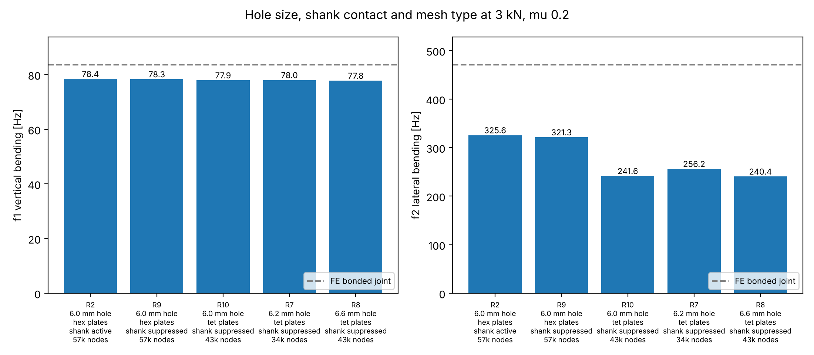
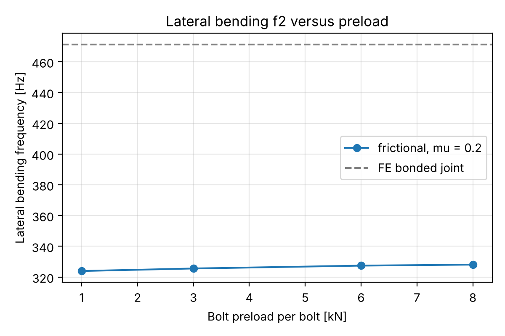
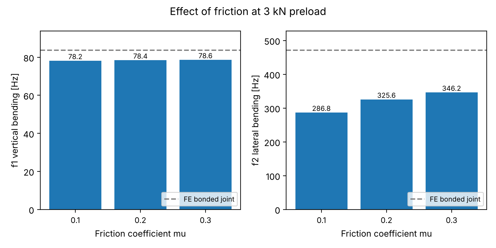
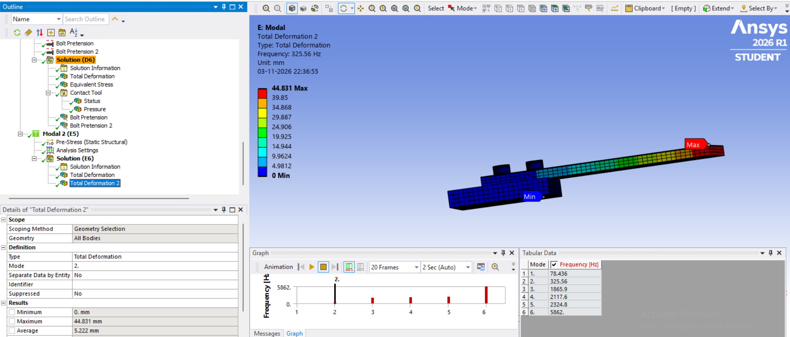
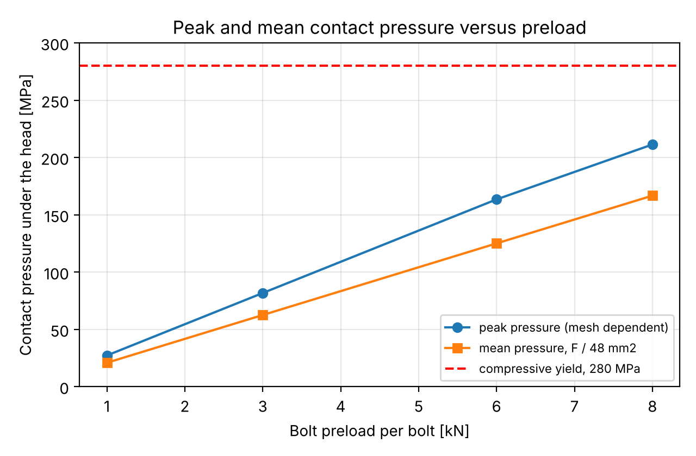
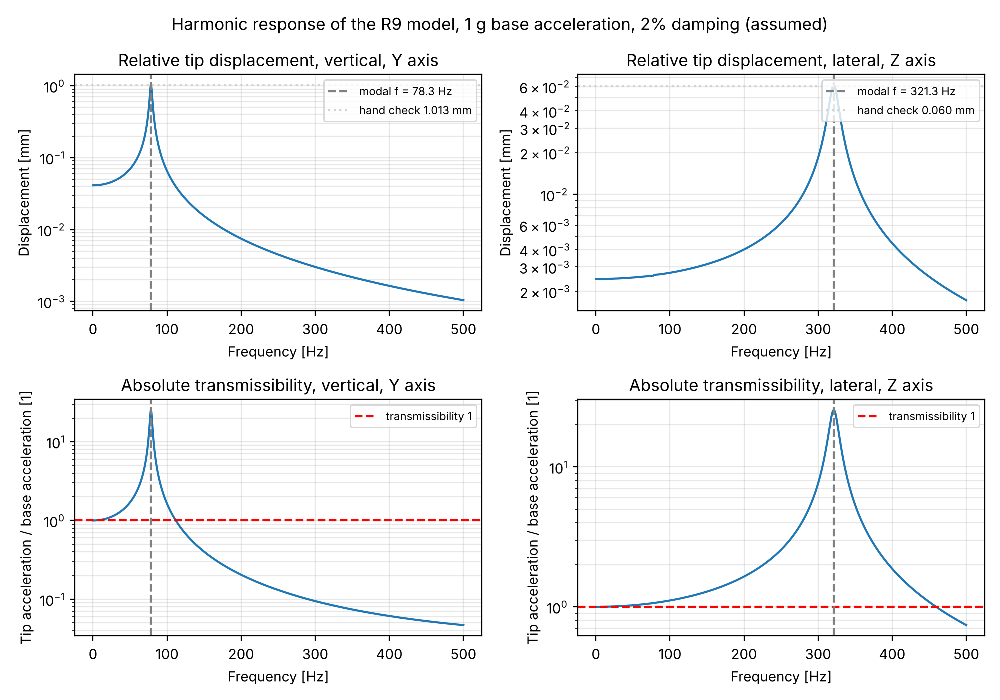

# Preloaded bolted bracket: how much do preload, friction and hole clearance change the vibration modes?

Joint stiffness study in Ansys Mechanical 2026 R1 (Student). A 140 x 40 x 6 mm aluminium bracket is clamped to a base block with two preloaded M6 bolts and carries a 0.5 kg tip mass. Prestressed modal analysis in ten runs, plus a harmonic response on the baseline model.

## Key findings

1. **Preload barely matters.** From 1 to 8 kN per bolt, f1 rises by 0.24% and f2 by 1.3%.
2. **Friction matters for the lateral mode.** From mu 0.1 to 0.3, f2 rises by 21%. f1 changes by 0.6%.
3. **A bonded joint is 36 to 64% too stiff laterally.** Bonded f2 is 471 Hz, the frictional joint gives 287 to 346 Hz.
4. **Hole size does not drive f2.** Enlarging the hole from 6.0 to 6.6 mm changes f2 by 0.5%, removing the shank contact by 1.3%. Switching the plates from hex to tet elements changes it by 25%, so the absolute lateral frequency is uncertain by about plus or minus 15% until a finer hex mesh study narrows it.
5. **f1 is robust.** All runs at 3 kN and mu 0.2 give f1 within 1%.
6. **Harmonic response.** With 1 g base acceleration and an assumed 2% damping, the tip moves 1.03 mm at f1 (vertical) and 0.061 mm at f2 (lateral). Both peaks match a hand check within 3%, and the tip acceleration is amplified by about 25 at each resonance. Above about 112 Hz (vertical) and 460 Hz (lateral) the tip sees less acceleration than the base.
7. **Contact pressure.** The peak (211 MPa at 8 kN) depends on the mesh. The mean pressure under the head is 167 MPa at 8 kN, 60% of the 280 MPa compressive yield of the aluminium.

## Model

| Item | Value |
|---|---|
| Parts | bracket and base block (aluminium, E 71 GPa, yield 280 MPa), two M6 x 16 socket head bolts (default structural steel), 0.5 kg tip mass |
| Contacts | frictional between bracket and block and under the bolt heads, bonded bolt thread to block |
| Analysis | Static Structural with bolt pretension, then a linked prestressed Modal (contact status frozen) |
| Checks | hand calculation 86.8 Hz, bonded FE 83.71 Hz, bonded mesh convergence within 0.13% |

## Results

3 kN and mu 0.2 unless stated. Raw data in `data/results.csv`, solver output in `solver_output/`.

| Case | Preload (kN) | mu | Hole (mm) | Plates | Shank contact | f1 (Hz) | f2 (Hz) | Peak pressure (MPa) |
|---|---|---|---|---|---|---|---|---|
| R1 | 1 | 0.2 | 6.0 | hex | active | 78.39 | 323.9 | 27 |
| R2 | 3 | 0.2 | 6.0 | hex | active | 78.44 | 325.6 | 82 |
| R3 | 6 | 0.2 | 6.0 | hex | active | 78.57 | 327.4 | 163 |
| R4 | 8 | 0.2 | 6.0 | hex | active | 78.58 | 328.1 | 211 |
| R5 | 3 | 0.1 | 6.0 | hex | active | 78.17 | 286.8 | 82 |
| R6 | 3 | 0.3 | 6.0 | hex | active | 78.64 | 346.2 | 82 |
| R9 | 3 | 0.2 | 6.0 | hex | suppressed | 78.31 | 321.3 | 82 |
| R10 | 3 | 0.2 | 6.0 | tet | suppressed | 77.93 | 241.6 | 72 |
| R7 | 3 | 0.2 | 6.2 | tet | suppressed | 78.02 | 256.2 | 78 |
| R8 | 3 | 0.2 | 6.6 | tet | suppressed | 77.78 | 240.4 | 84 |

Bonded reference: f1 = 83.71 Hz, f2 = 471.27 Hz.

<table>
<tr>
<td></td>
<td></td>
</tr>
<tr>
<td> R2, lateral mode, 325.56 Hz</td>
<td></td>
</tr>
</table>

## Harmonic response

Mode superposition on the prestressed modal of R9 (hex plates, 6.0 mm hole, shank contact suppressed, 3 kN, mu 0.2). Base acceleration 1 g (9806.65 mm/s2) in the vertical Y and lateral Z directions, 2% constant damping, 0.5 to 500 Hz in 0.5 Hz steps, tip vertex results.

| Direction | Resonance (Hz) | Peak tip displacement (mm) | Hand check (mm) | Peak transmissibility |
|---|---|---|---|---|
| Vertical (Y), f1 | 78.3 | 1.03 | 1.01 | 25.2 |
| Lateral (Z), f2 | 321.2 | 0.061 | 0.060 | 25.5 |

Hand check: a / (w^2 x 2 zeta) with a = 1 g, w = 2 pi f and zeta = 0.02. Transmissibility is the absolute tip acceleration divided by the base acceleration, so the peak should be 1 / (2 zeta) = 25.

The damping ratio is assumed, not measured, and the contact status is still frozen, so the response is linear. Data in `data/harmonic/`, plot script `scripts/plot_harmonic.py`.

## Limitations

* The contact status is frozen in the prestressed modal, so slip and impacts in a loose hole are not modelled. That needs a nonlinear transient study.
* The frictional f2 differs by 25% between hex and tet plate meshes. Only a finer hex mesh study can show whether f2 converges.
* Bolts use the default steel (250 MPa yield), not an 8.8 grade. Peak pressure and bolt corner stress are mesh dependent local values.
* The 2% damping in the harmonic response is an assumption. Real bolted joints add friction damping that this linear model does not capture.
* Simulation only. The model is checked against a hand calculation and a bonded mesh convergence study, not against a physical test.

## Next steps

1. Finer hex mesh around the contacts to check whether f2 converges.
2. Nonlinear transient with a loose hole, to capture slip and impacts that the linear harmonic response cannot.
3. Compare the joint stiffness with a published analytical joint model (VDI 2230 style compliance).

## Repository layout

| Path | Content |
|---|---|
| `cad/` | CAD files |
| `data/` | results table, harmonic response exports, and the superseded first 6.2 mm run |
| `figures/` | plots made by `scripts/plot_results.py` and `scripts/plot_harmonic.py` |
| `screenshots/` | Ansys screenshots |
| `solver_output/` | MAPDL solver output for R3, R7, R8, R9, R10 |
| `scripts/` | hand calculation, plotting, drawings |
| `docs/` | bracket drawings and `detailed_notes.md` with all checks, screenshots and lessons |
