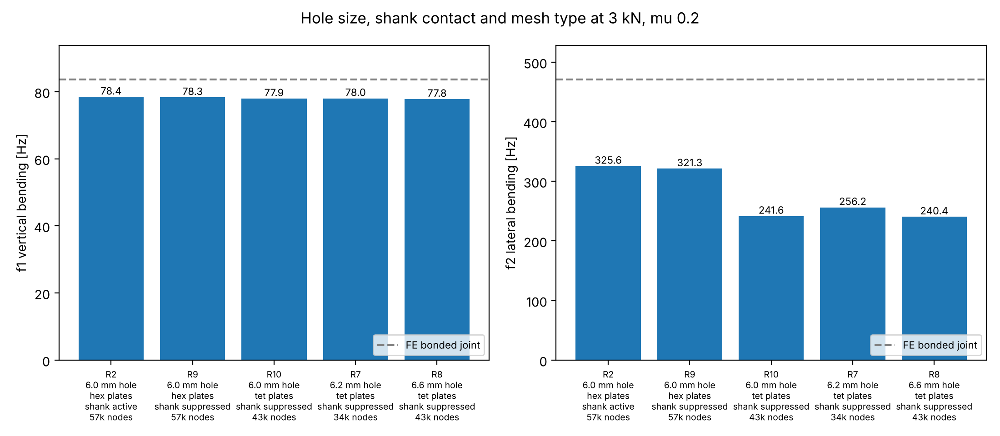
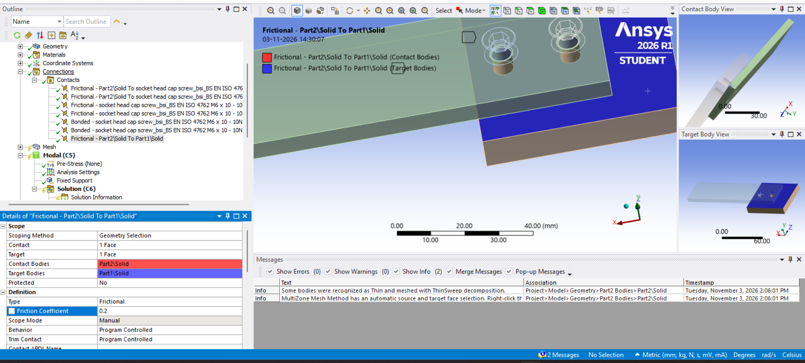
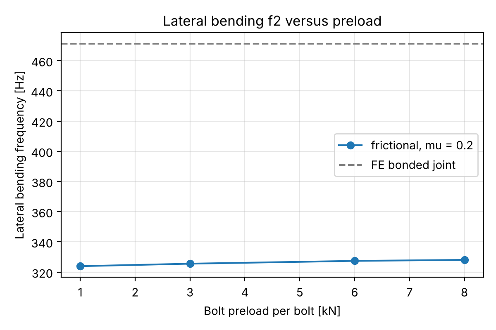
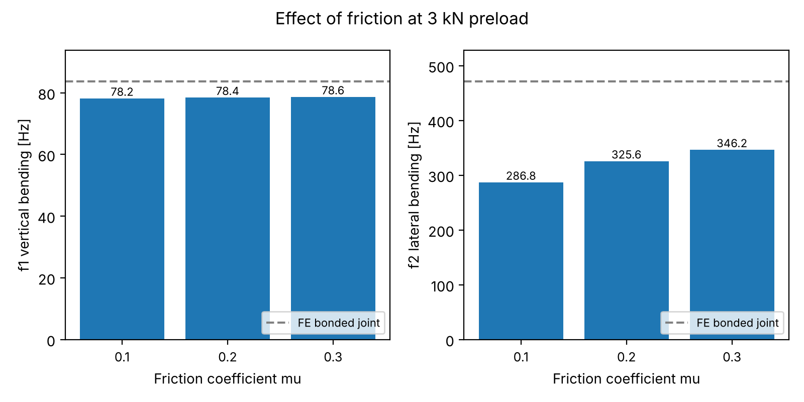
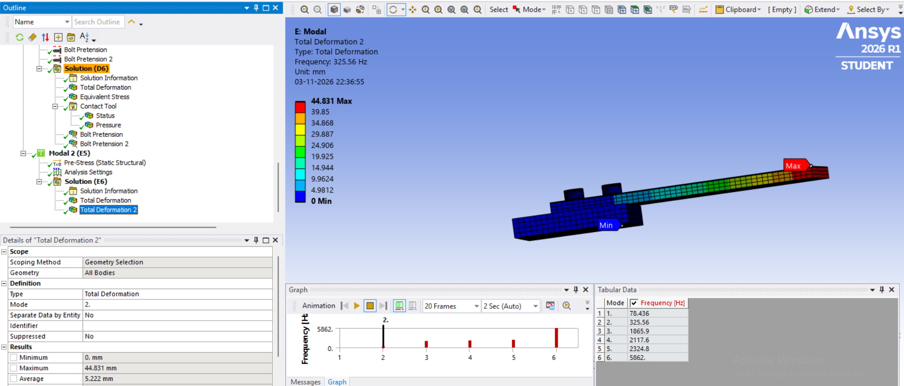
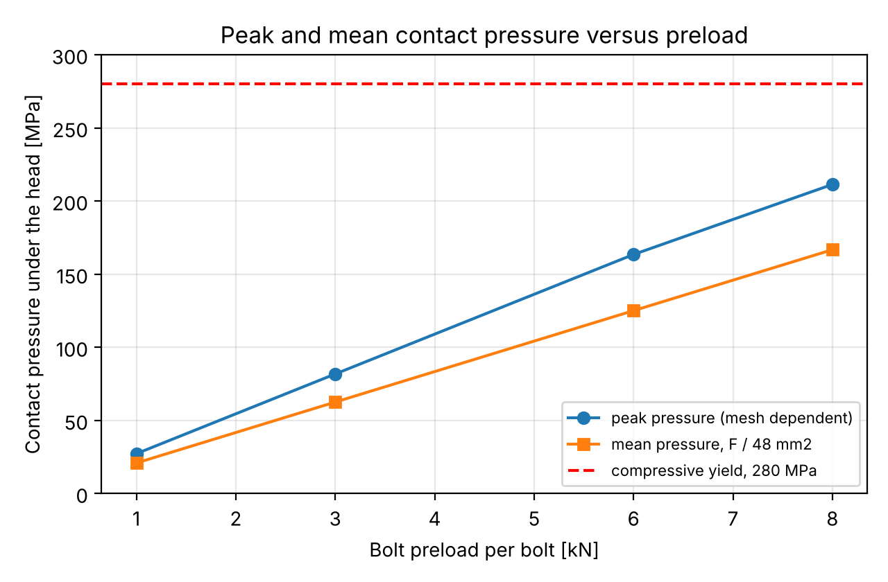
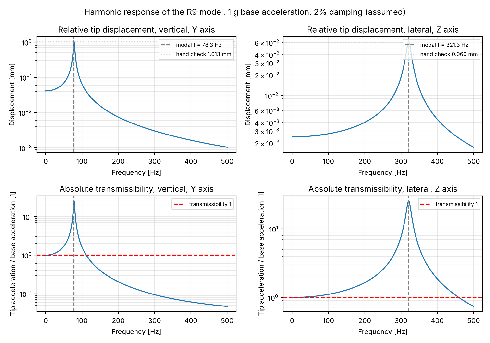
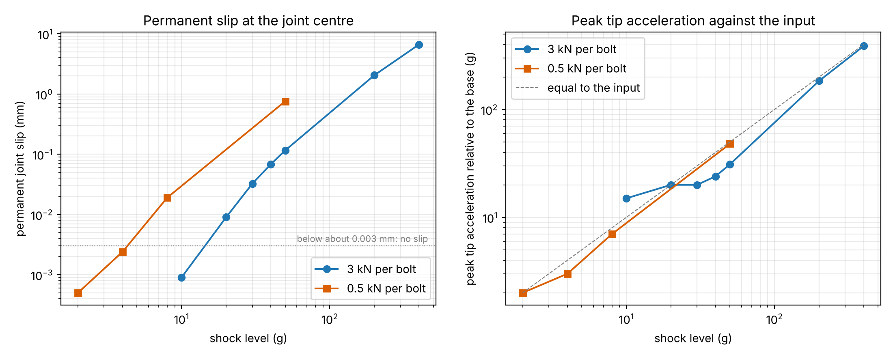

# Detailed notes: preloaded bolted bracket study

Full write up with all screenshots, checks and limitations. The short version is in the main README.

A joint stiffness study in Ansys Mechanical 2026 R1 (Student). A 140 x 40 x 6 mm aluminium bracket is clamped to a base block with two preloaded M6 bolts and carries a 0.5 kg tip mass. The question is how much the first natural frequencies depend on the joint, and how wrong a simple bonded contact is. Later parts add a harmonic response in Ansys and a reduced cross check in Abaqus Learning Edition 2026.



## Summary

1. **Preload barely matters for the frequencies.** From 1 to 8 kN per bolt, f1 rises by 0.24% and f2 by 1.3%.
2. **Friction matters for the lateral mode.** From mu 0.1 to 0.3, f2 rises by 21%, while f1 changes by 0.6%.
3. **A bonded joint is far too stiff in the lateral direction.** Bonded f2 is 471 Hz, the frictional joint gives 287 to 346 Hz, so bonded is 36 to 64% too stiff in that mode.
4. **Hole size is not what drives f2 here.** With the same mesh, enlarging the hole from 6.0 to 6.6 mm changes f2 by 0.5%. Removing the bolt shank contact changes it by 1.3%. Switching the plates from hexahedra to tetrahedra changes it by 25%. The lateral frequency of a frictional joint therefore carries a model uncertainty from the contact discretisation, which a finer hex mesh study could narrow down.
5. **f1 is robust.** All five runs at 3 kN and mu 0.2 (R2, R7, R8, R9, R10) give f1 within 1% of each other.
6. **The harmonic response confirms the modes and the damping amplification.** With 1 g base acceleration and an assumed 2% damping, the tip moves 1.03 mm at f1 and 0.061 mm at f2. Both peaks match a hand check within 3%, and the tip acceleration is amplified by about 25 at each resonance.
7. **The Abaqus cross check agrees on f1 and shows when the joint slips.** f1 agrees with Ansys within 1.3%. Abaqus did not reproduce the strong effect of friction on f2, and the cause is open. Under a lateral shock the joint starts to slip at about 10 to 20 g with 3 kN per bolt and at about 2 to 4 g with 0.5 kN per bolt, as a hand estimate from the friction couple of the two bolts predicts.

## Model

| Item | Value |
|---|---|
| Bracket | 140 x 40 x 6 mm, free length 100 mm, aluminium alloy |
| Base block | aluminium alloy, fixed support on the block |
| Bolts | two M6 x 16 socket head bolts, 10 mm thread engagement in the block |
| Tip mass | 0.5 kg point mass at the free end |
| Aluminium | E 71 GPa, density 2770 kg/m3, yield 280 MPa (tension and compression), ultimate 310 MPa |
| Bolt material | Ansys default structural steel, E 200 GPa, density 7850 kg/m3, yield 250 MPa. Not an 8.8 grade, see limitations |
| Contacts | frictional between bracket and block and under both bolt heads (Augmented Lagrange, Adjust to Touch), bonded between bolt thread and block |
| Preload | Bolt Pretension, defined by load in step 1, locked in step 2 |
| Analysis chain | Static Structural with large deflection, then a linked prestressed Modal (linear perturbation, contact status frozen from the static result) |
| Mesh, main study | about 57,500 nodes, hexahedral plates, patch conforming tetrahedra on the bolts, 2 mm on the bolts |

Drawings: `bracket_drawing.pdf` and `bracket_section_view.pdf`.

<table>
<tr>
<td><br><sub>Assembly geometry</sub></td>
<td><br><sub>Bolt Pretension, 3000 N</sub></td>
</tr>
<tr>
<td><br><sub>Frictional contact, mu 0.2</sub></td>
</tr>
<tr>
<td><br><sub>Engineering data</sub></td>
<td><br><sub>Mesh overview from the bonded convergence study, 78,537 nodes</sub></td>
</tr>
</table>

## Checks before the sweep

| Check | Result |
|---|---|
| Hand calculation, cantilever with tip mass, rigid clamp (`scripts/handcalc.py`) | f1 = 86.8 Hz |
| FE with a bonded joint, 3 mm mesh | f1 = 83.71 Hz, 3.6% below the rigid clamp value, as expected for a clamp that is not rigid |
| Mesh convergence of the bonded model, 3, 2 and 1.5 mm | 83.71, 83.82, 83.72 Hz, within 0.13% |
| Bonded f2 on the 3 mm mesh | 471.27 Hz |

<table>
<tr>
<td><br><sub>Bonded model, mode 1, 83.71 Hz</sub></td>
<td><br><sub>Bonded model, mode 2, 471.27 Hz</sub></td>
</tr>
</table>

## Results

All runs: 3 kN per bolt unless stated, mu 0.2 unless stated. Raw data in `data/results.csv`, solver output in `solver_output/`.

| Case | Preload (kN) | mu | Hole (mm) | Plate mesh | Shank contact | Nodes | f1 (Hz) | f2 (Hz) | f3 (Hz) | Peak pressure (MPa) |
|---|---|---|---|---|---|---|---|---|---|---|
| R1 | 1 | 0.2 | 6.0 | hex | active | 57,582 | 78.387 | 323.92 | 1864.5 | 27.2 |
| R2 | 3 | 0.2 | 6.0 | hex | active | 57,582 | 78.436 | 325.56 | 1865.9 | 81.7 |
| R3 | 6 | 0.2 | 6.0 | hex | active | 57,582 | 78.574 | 327.42 | 1869.9 | 163.4 |
| R4 | 8 | 0.2 | 6.0 | hex | active | 57,582 | 78.579 | 328.08 | 1870.1 | 211.3 |
| R5 | 3 | 0.1 | 6.0 | hex | active | 57,582 | 78.174 | 286.78 | 1858.4 | 81.9 |
| R6 | 3 | 0.3 | 6.0 | hex | active | 57,582 | 78.644 | 346.24 | 1872.1 | 81.5 |
| R9 | 3 | 0.2 | 6.0 | hex | suppressed | 57,581 | 78.310 | 321.30 | 1861.5 | 82.1 |
| R10 | 3 | 0.2 | 6.0 | tet | suppressed | 43,859 | 77.931 | 241.61 | 1849.0 | 72.4 |
| R7 | 3 | 0.2 | 6.2 | tet | suppressed | 34,153 | 78.015 | 256.20 | 1852.5 | 78.0 |
| R8 | 3 | 0.2 | 6.6 | tet | suppressed | 43,852 | 77.782 | 240.43 | 1844.4 | 83.9 |

Bonded references: f1 = 83.71 Hz and f2 = 471.27 Hz (hex, 3 mm mesh, 6.0 mm hole). On the tet mesh with the 6.6 mm hole the bonded model gives f1 = 83.92 Hz, f2 = 471.44 Hz, f3 = 2039.4 Hz, so a bonded joint does not feel the hole size or the mesh type.

### Preload and friction

<table>
<tr>
<td></td>
<td></td>
</tr>
<tr>
<td colspan="2" align="center"></td>
</tr>
</table>

The first bending mode (vertical, f1) bends the thin direction and is dominated by the beam, so it hardly sees the joint. The lateral mode (f2) bends the bracket in its stiff 40 mm direction, so the clamp has to carry a large shear and moment through friction at the interface. A plausible reason for the pattern is that friction decides how much of that interface sticks, while extra preload adds little once the interface already sticks at 1 kN. I did not separate this further. The Abaqus cross check below did not reproduce the friction effect in its linear modal analysis, so the size of the effect depends on the solver and I would treat it as a trend, not a number.

<table>
<tr>
<td><br><sub>R2, mode 2 (lateral bending), 325.56 Hz</sub></td>
<td><br><sub>R2, contact status after preload</sub></td>
</tr>
<tr>
<td><br><sub>R1, frequency table, 1 kN</sub></td>
<td><br><sub>R4, frequency table, 8 kN</sub></td>
</tr>
<tr>
<td><br><sub>R5, mu 0.1</sub></td>
<td><br><sub>R6, mu 0.3</sub></td>
</tr>
</table>

### Hole clearance, shank contact and mesh type

I wanted to know whether a hole larger than the bolt changes the modes. In a linear prestressed modal analysis the answer depends on what carries the load between bolt shank and bracket hole, so I separated three effects at 3 kN and mu 0.2.

| Comparison | Only difference | f2 change |
|---|---|---|
| R2 to R9 | shank to hole contact removed (6.0 mm hole, hex) | 325.56 to 321.30 Hz, minus 1.3% |
| R10 to R8 | hole 6.0 to 6.6 mm (tet, shank contact suppressed) | 241.61 to 240.43 Hz, minus 0.5% |
| R9 to R10 | plates from hex to tet (6.0 mm, shank contact suppressed) | 321.30 to 241.61 Hz, minus 25% |

Conclusions:
* Once the shank contact is suppressed, the hole size has almost no effect on the linear result, because nothing in the model touches the hole wall. Real clearance acts through impacts and slip, which needs a nonlinear transient study.
* The 25% jump between hex and tet plates appears only with friction on. The bonded model gives the same f2 on both meshes (471.27 and 471.44 Hz), so the plates are equally stiff. What differs is the stick and slip state at the bolt head and the bracket interface after preload, and that state depends on the mesh. I cannot say which mesh is closer to reality without a physical test, which this project does not include. Hex elements are normally preferred for contact, which is why the preload and friction sweeps use them.
* For the application this means: trust the trends of the sweeps (preload weak, friction strong), and treat the absolute lateral frequency as uncertain by about plus or minus 15% until a finer hex mesh study narrows it.

<table>
<tr>
<td><br><sub>R9, 6.0 mm, hex, 57k nodes, peak 82.1 MPa</sub></td>
<td><br><sub>R10, 6.0 mm, tet, 44k nodes, peak 72.4 MPa</sub></td>
</tr>
<tr>
<td><br><sub>R7, 6.2 mm, tet, 34k nodes, peak 78.0 MPa</sub></td>
<td><br><sub>R8, 6.6 mm, tet, 44k nodes, peak 83.9 MPa</sub></td>
</tr>
<tr>
<td colspan="2" align="center"><br><sub>Bonded check on the tet mesh, 6.6 mm hole, f2 = 471.44 Hz (the window title still reads 6.2 because the modal feature was copied)</sub></td>
</tr>
</table>

### Contact pressure and stress



The peak pressure (blue) grows linearly with preload but is a local edge value that depends on the mesh. At 3 kN it reads 72 to 84 MPa on meshes of 34k to 57k nodes. A first, superseded run on a 92k node mesh with face sizing read 211 MPa at 3 kN (`screenshots/pressure_peak/`), the same number as the 8 kN peak on the 57k mesh, which is a coincidence and not a result. The mean pressure under the head (orange, preload divided by an estimated ring area of 48 mm2) is mesh independent: 62, 125 and 167 MPa at 3, 6 and 8 kN. At 8 kN the mean is 60% of the 280 MPa compressive yield of the aluminium. The pressure plots show the highest values at the inner edge of the contact ring next to the hole, consistent with the head dishing slightly under load. A hardened washer would spread that load.

Stress at 8 kN (`screenshots/stress/`):
* Bracket peak 202 MPa, below the 280 MPa yield.
* Bolt peak 707 MPa at the sharp head to shank corner, which has no fillet in the model, so this is a singularity. The nominal bolt stress is 8000 N over the 20.1 mm2 stress area, about 398 MPa. That is above the 250 MPa yield of the default steel used in the model, but below the 640 MPa yield of a real 8.8 bolt (62%). The analysis is linear, so the value is not capped at yield, and the bolt grade does not change any frequency.

<table>
<tr>
<td><br><sub>R2, 3 kN, peak 81.7 MPa</sub></td>
<td><br><sub>R3, 6 kN, peak 163.4 MPa</sub></td>
<td><br><sub>R4, 8 kN, peak 211.3 MPa</sub></td>
</tr>
<tr>
<td><br><sub>R5, mu 0.1, peak 81.9 MPa</sub></td>
<td><br><sub>R6, mu 0.3, peak 81.5 MPa</sub></td>
<td><br><sub>Superseded 92k mesh run, 3 kN, peak 211.5 MPa</sub></td>
</tr>
<tr>
<td><br><sub>Von Mises stress, all bodies, 8 kN</sub></td>
<td><br><sub>Bracket, 8 kN, 202 MPa</sub></td>
<td><br><sub>Bolt head to shank corner, 707 MPa</sub></td>
</tr>
</table>

## Harmonic response

A mode superposition harmonic response on the prestressed modal of R9 (hex plates, 6.0 mm hole, shank contact suppressed, 3 kN, mu 0.2, modal f1 78.31 Hz, f2 321.30 Hz, f3 1861.5 Hz). It answers how large the tip motion is at resonance for a given base acceleration, which a modal analysis alone cannot.

| Item | Value |
|---|---|
| Load | base acceleration of 1 g, which is 9806.65 mm/s2 because the model is in mm, applied to all bodies in the global coordinate system |
| Directions | vertical case on the Y axis (f1 bending), lateral case on the Z axis (f2 bending). X is the axial direction |
| Damping | constant damping ratio of 2%, an assumption and not a measurement |
| Frequencies | 0.5 to 500 Hz in 1000 steps, entered as a User Defined Frequencies table. The Cluster Number field of this version gave only 4 substeps and there is no Solution Intervals field |
| Output | tip vertex displacement and acceleration, complex values, exported as CSV in `data/harmonic/` (columns frequency, displacement, displacement phase, acceleration, acceleration phase) |

| Direction | Resonance (Hz) | Peak tip displacement (mm) | Hand check (mm) | Peak transmissibility |
|---|---|---|---|---|
| Vertical (Y), f1 | 78.3 | 1.03 | 1.01 | 25.2 |
| Lateral (Z), f2 | 321.2 | 0.061 | 0.060 | 25.5 |



Hand check: the peak relative tip displacement is a / (w^2 x 2 zeta), with a = 1 g, w = 2 pi f and zeta = 0.02. The transmissibility is the absolute tip acceleration divided by the base acceleration, 1 plus the complex relative acceleration over the base acceleration, so its peak should be 1 / (2 zeta) = 25. Both numbers match. At low frequency the displacement approaches a / w^2 times the modal participation factor of about 1.02, which also matches. Above about 112 Hz (vertical) and 460 Hz (lateral) the tip sees less acceleration than the base.

The contact status is still frozen, so the response is linear and cannot show slip. The 2% damping is an assumed value and has to be replaced by a measured one before the amplitudes mean anything absolute. Plot script `scripts/plot_harmonic.py`.

## Abaqus cross check

I wanted a second solver to see which findings survive. Abaqus Learning Edition 2026 is free but limits a model to 1000 nodes, and the Ansys model has about 57,000, so the joint was rebuilt as a reduced model. THD has no Abaqus licence collaboration, so the Learning Edition is the only option here. The model is built by Python scripts in `abaqus/`, which run once through File, Run Script in Abaqus/CAE.

| Item | Value |
|---|---|
| Units | mm, tonne, N, s, MPa |
| Bracket | 140 x 40 x 6 mm solid, C3D8I elements on a 5 mm grid, 2 elements through the thickness, 448 elements and 783 nodes. Y is the thickness and bending direction, Z the lateral direction, as in Ansys |
| Base block | 50 x 10 x 60 mm aluminium solid, 4 elements and 18 nodes, fixed on its bottom face. 801 nodes in total |
| Material | E 71 GPa, Poisson ratio 0.33, density 2770 kg/m3, same as the Ansys aluminium |
| Joint | surface to surface contact between bracket and block with penalty friction. The clamp force is a pressure on a 10 x 10 mm patch under each bolt (at x = 10 and 30 mm), equal to the preload divided by 100 mm2 |
| Tip mass | 0.5 kg point mass on a reference point at the end face centre, coupled to the end face |
| Not modelled | bolts, bolt holes, bolt head contact. Slip is limited by friction only |
| Damping (shock runs) | Rayleigh mass proportional, 19.96 per second, which is 2% at 79.4 Hz |

The scripts build up in four steps.

| Step | Script | What it does |
|---|---|---|
| 1 | `step1_fixed_clamp_modal.py` | rigid clamp, modal. Checks the setup |
| 2 | `step2_friction_preload_modal.py` | friction contact and clamp pressure, prestressed modal, six cases mirroring R1 to R6 |
| 3 | `step3_tie_check_and_shock.py` | bonded tie control, then nonlinear shock runs with friction in every increment |
| 4 | `step4_slip_onset.py` | the same shock model at lower levels to find where slip starts |

### Linear modes

| Model | f1 (Hz) | f2 (Hz) |
|---|---|---|
| Abaqus rigid clamp (hand calculation 86.8 Hz) | 86.1 | 515.8 |
| Abaqus bonded tie | 85.7 | 497.5 |
| Abaqus friction contact, prestressed modal | 79.4 | 411.5 |
| Ansys bonded | 83.7 | 471.3 |
| Ansys friction contact (R2) | 78.4 | 325.6 |

* f1 of the frictional model agrees with Ansys within 1.3%, and the rigid clamp is close to the hand calculation.
* In Abaqus all six preload and friction cases give identical frequencies (79.4 and 411.5 Hz for preload 1 to 8 kN and mu 0.1 to 0.3). The strong friction effect on f2 seen in Ansys was not reproduced.
* I expected the frictional model to equal the bonded tie, on the idea that a sticking contact is treated as bonded in the linear step. It does not: the frictional model is 7% softer in f1 and 17% softer in f2 than the tie. So that explanation was wrong, and I do not know yet why the frictional joint is softer than the tie and independent of preload and friction. It stays an open point.
* The lateral f2 of the frictional joint is 26% higher in Abaqus than in Ansys, which fits the model uncertainty of the lateral mode stated above.

### Nonlinear shock

A half sine shock of 5 ms in the lateral direction, applied as a time varying acceleration on the model with a fixed base, followed by free decay to 30 ms. Results are relative to the base. The final joint displacement is the permanent slip, measured at the bracket bottom in the middle between the bolts.

| Preload per bolt | mu | Shock (g) | Peak tip U3 (mm) | Peak tip acceleration (g) | Permanent slip (mm) |
|---|---|---|---|---|---|
| 0.5 kN | 0.2 | 2 | 0.163 | 2 | 0.0005 |
| 0.5 kN | 0.2 | 4 | 0.346 | 3 | 0.0024 |
| 0.5 kN | 0.2 | 8 | 0.986 | 7 | 0.019 |
| 0.5 kN | 0.1 | 50 | 36.0 | 49 | 0.901 |
| 0.5 kN | 0.2 | 50 | 29.5 | 48 | 0.757 |
| 0.5 kN | 0.3 | 50 | 22.9 | 46 | 0.593 |
| 3 kN | 0.2 | 10 | 0.247 | 15 | 0.0009 |
| 3 kN | 0.2 | 20 | 0.661 | 20 | 0.009 |
| 3 kN | 0.2 | 30 | 1.50 | 20 | 0.032 |
| 3 kN | 0.2 | 40 | 2.81 | 24 | 0.068 |
| 3 kN | 0.2 | 50 | 4.59 | 31 | 0.116 |
| 3 kN | 0.2 | 200 | 81.7 | 184 | 2.05 |
| 3 kN | 0.2 | 400 | 126 | 387 | 6.66 |



* **Slip onset.** At 3 kN the joint is still at 0.0009 mm after 10 g and starts to slip at 20 g. At 0.5 kN it is still at 0.0005 mm after 2 g and starts to slip at 4 g. I counted a permanent shift above about 0.003 mm as slip.
* **Friction limit.** At 3 kN the peak tip acceleration stays at about 20 g for inputs of 20 and 30 g. Once the joint slips, it limits the load that reaches the tip.
* **Preload decides if the joint slips, friction decides how far.** At 50 g, 6 times the preload cuts the tip excursion from 29.5 to 4.6 mm and the slip from 0.76 to 0.12 mm. At 0.5 kN, going from mu 0.1 to 0.3 cuts the slip by 34%.
* **The two runs at 200 and 400 g** show tip movements of 82 and 126 mm. The bracket rotates about the joint, so they only show that the joint lets go.

### Hand estimate of the slip onset

A lateral load on the tip is a moment about the vertical axis. The two bolts are only 20 mm apart, so they carry the moment as a friction couple, with a lever of about 120 mm from the bolt centre to the tip.

* Capacity per bolt is mu times the preload, 600 N at 3 kN.
* Couple capacity is about 600 N x 20 mm = 12 N m. The tip force that reaches it is 12 N m / 0.12 m = 100 N. For the 0.59 kg assembly this is 17 g. Torsion friction under each bolt head adds some capacity, which raises the estimate to about 25 g.
* At 0.5 kN the same estimate gives about 3 g.

The model slips between 10 and 20 g and between 2 and 4 g, so the estimate holds. My first estimate was wrong by a factor of ten. I had treated the joint as a friction pad that has to resist only the shear force, which gave about 200 g. Treating it as a couple between two bolts 20 mm apart is what matches the model. This also explains why the lateral mode depends on the joint: the yaw stiffness of the bolt pair sets f2.

At 3 kN the slip is 0.12 mm at 50 g, which is below the 0.3 mm gap between a 6.0 mm shank and a 6.6 mm hole. At 0.5 kN it is 0.76 mm at 50 g, so the clearance would start to matter at low preload. The model has no holes, so it cannot show this directly.

### Caveats

* The mesh is coarse and the friction is a penalty formulation. The numbers show trends and are not predictions.
* The model has no bolts or holes, and the clamp force is a pressure, so the stress in the bolts and the clearance impacts are not covered.
* Scripting against Abaqus 2026 needed a few keyword fixes. For example, the contact definition now uses main and secondary instead of master and slave.

## How I checked the runs

The solver output has a mass summary by element type that works as a fingerprint of the model. It caught two mistakes in this study.

| Item | Mass |
|---|---|
| Bolt, M6 x 16 | 6.61 g (the Toolbox default M6 x 10 weighs 5.29 g) |
| Bracket, 6.0 mm holes | 92.13 g |
| Bracket, 6.2 mm holes | 92.06 g |
| Bracket, 6.6 mm holes | 91.93 g |
| Plate elements | SOLID186 means hexahedra, SOLID187 means tetrahedra |

The solver prints the masses in tonne (mm, tonne, N, s units), so 6.61 g appears as 0.661E minus 05.

* My first 6.2 mm run looked like a large clearance effect. The mass summary showed it used the short M6 x 10 bolts (the CAD library template had reverted), on a different mesh. That run is kept as `data/results_superseded.csv` and was not used. It was repeated with the correct bolts as R7.
* A later run that was meant to be 6.0 mm reproduced the 6.6 mm result to nine digits. The bracket mass showed the geometry had not been updated. After refreshing the geometry the mass matched 6.0 mm and the result changed.
* An early modal with several 0 Hz modes came from a missing Fixed Support in the static system. The solver output reports it as "No constraints have been defined".
* The first harmonic run had only 4 substeps because the Cluster Number field set them, so the curve was coarse. A table of 1000 User Defined Frequencies fixed that.
* The first lateral harmonic export showed no f2 peak, and two exports were identical. The acceleration components were X = 9806.6, Y = 9806.6 and Z = 0, but X is the axial direction. Setting X = 0, Y = 9806.6 and Z = 9806.6 for the two cases gave the f2 peak at 321 Hz.
* The Abaqus imported STEP model was in metres (a 60 mm edge measured 60.E-03 in the Query tool), so I built the model from scratch in mm instead. The unit mistake would have changed every number.

## Limitations

* The contact status is frozen in the prestressed modal analysis. The study shows how preload and friction act through the contact state at lock, not slip under vibration. Amplitude dependent behaviour (impacts in a loose hole, microslip) needs a nonlinear transient study. The Abaqus shock runs give a first look at slip, without bolt holes.
* Peak pressure and the bolt corner stress depend on the mesh. They are local peaks, not design values.
* The lateral frequency of the frictional joint differs by about 25% between hex and tet plate meshes (see above). A finer hex mesh study of the contact has not been done.
* The student licence limits the node count, which restricts how far the whole model can be refined.
* The bolt material is the default structural steel, not an 8.8 grade. The stiffness difference (200 against about 210 GPa) is small, and the stress comparison uses the real 8.8 yield value.
* The mean pressure uses an estimated contact ring area of 48 mm2.
* Simulation only, no physical test. The model is checked against a hand calculation and a bonded convergence study only.
* The tip mass is idealised as a rigid point at the end of the bracket.
* The 2% damping in the harmonic response is assumed. Real bolted joints add friction damping that the linear model does not capture.
* The Abaqus model is limited to 1000 nodes. It has no bolts or holes, a coarse base block, and the clamp force acts as pressure under the bolt heads.
* Abaqus does not reproduce the strong friction effect on f2 seen in Ansys, and I have not found out why.

## Next steps

1. Compare the joint stiffness with a published analytical joint model (VDI 2230 style compliance).
2. Finer hex mesh around the contacts to see whether f2 converges.
3. Find out why the linear modes in Abaqus do not see the friction coefficient while Ansys does, for example by varying the contact stiffness settings in Ansys.
4. A nonlinear shock model with bolts and clearance holes, to see when the shank hits the hole wall. It needs more nodes than the Learning Edition allows.

## Reproduce

```
python3 scripts/handcalc.py       # hand calculation, 86.8 Hz
python3 scripts/plot_results.py   # regenerates the sweep figures from data/results.csv
python3 scripts/plot_harmonic.py  # harmonic response figure from data/harmonic/
python3 scripts/plot_abaqus.py    # Abaqus shock figure from data/abaqus/
```

The Abaqus scripts in `abaqus/` need Abaqus/CAE (the free Learning Edition works). Set a work directory, then File, Run Script, and pick one script. Each prints a summary and writes a results text file to the work directory.

Requires Python 3 and matplotlib. The Ansys project itself is not included because of its size. The solver output files in `solver_output/` contain the full model definition, contacts, mass summary and frequency tables for runs R3, R7, R8, R9 and R10.

## Repository layout

| Path | Content |
|---|---|
| `data/results.csv` | all runs used in the study |
| `data/harmonic/` | tip displacement and acceleration against frequency, vertical and lateral |
| `data/abaqus/` | Abaqus shock results |
| `data/results_superseded.csv` | first 6.2 mm attempt with the wrong bolts, not comparable |
| `figures/` | plots made by `scripts/plot_results.py`, `scripts/plot_harmonic.py` and `scripts/plot_abaqus.py` |
| `screenshots/` | Ansys screenshots, grouped by setup, verification, sweep, stress, pressure peak and clearance |
| `solver_output/` | MAPDL solver output text files |
| `scripts/` | hand calculation, plotting, drawings |
| `abaqus/` | Abaqus scripts for the reduced model (steps 1 to 4) and the results of steps 1 to 3 |
| `docs/` | bracket drawings and these notes |