# Detailed notes: preloaded bolted bracket study

Full write up with all screenshots, checks and limitations. The short version is in the main README.

A joint stiffness study in Ansys Mechanical 2026 R1 (Student). A 140 x 40 x 6 mm aluminium bracket is clamped to a base block with two preloaded M6 bolts and carries a 0.5 kg tip mass. The question is how much the first natural frequencies depend on the joint, and how wrong a simple bonded contact is.

Author: Romikumar Kukadiya, M.Sc. Mechatronics and Cyberphysical Systems, TH Deggendorf. November 2026.


## Summary

1. **Preload barely matters for the frequencies.** From 1 to 8 kN per bolt, f1 rises by 0.24% and f2 by 1.3%.
2. **Friction matters for the lateral mode.** From mu 0.1 to 0.3, f2 rises by 21%, while f1 changes by 0.6%.
3. **A bonded joint is far too stiff in the lateral direction.** Bonded f2 is 471 Hz, the frictional joint gives 287 to 346 Hz, so bonded is 36 to 64% too stiff in that mode.
4. **Hole size is not what drives f2 here.** With the same mesh, enlarging the hole from 6.0 to 6.6 mm changes f2 by 0.5%. Removing the bolt shank contact changes it by 1.3%. Switching the plates from hexahedra to tetrahedra changes it by 25%. The lateral frequency of a frictional joint therefore carries a model uncertainty from the contact discretisation, which a finer hex mesh study could narrow down.
5. **f1 is robust.** All five runs at 3 kN and mu 0.2 (R2, R7, R8, R9, R10) give f1 within 1% of each other.

## Model

| Item | Value |
|---|---|
| Bracket | 140 x 40 x 6 mm, free length 100 mm, aluminium alloy |
| Base block | aluminium alloy, fixed support on the block |
| Bolts | two M6 x 16 socket head bolts, 10 mm thread engagement in the block |
| Tip mass | 0.5 kg point mass at the free end |
| Aluminium | E 71 GPa, density 2770 kg/m3, yield 280 MPa (tension and compression), ultimate 310 MPa |
| Bolt material | Ansys default structural steel, E 200 GPa, density 7850 kg/m3, yield 250 MPa. Not an 8.8 grade, see limitations |
| Contacts | frictional between bracket and block and under both bolt heads (Augmented Lagrange, Adjust to Touch), bonded between bolt thread and block |
| Preload | Bolt Pretension, defined by load in step 1, locked in step 2 |
| Analysis chain | Static Structural with large deflection, then a linked prestressed Modal (linear perturbation, contact status frozen from the static result) |
| Mesh, main study | about 57,500 nodes, hexahedral plates, patch conforming tetrahedra on the bolts, 2 mm on the bolts |

Drawings: `bracket_drawing.pdf` and `bracket_section_view.pdf`.

<table>
<tr>
<td>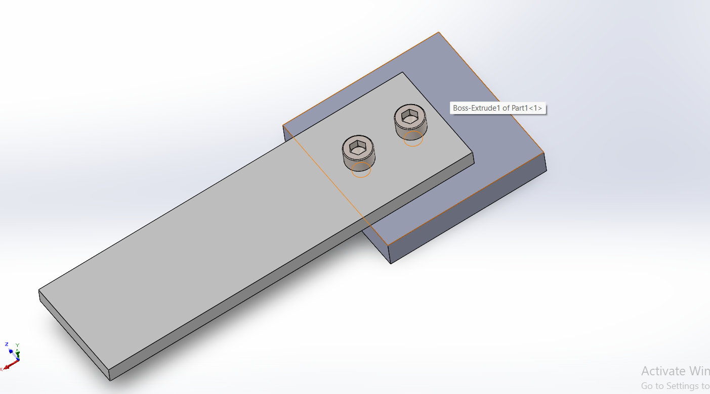<br><sub>Assembly geometry</sub></td>
<td>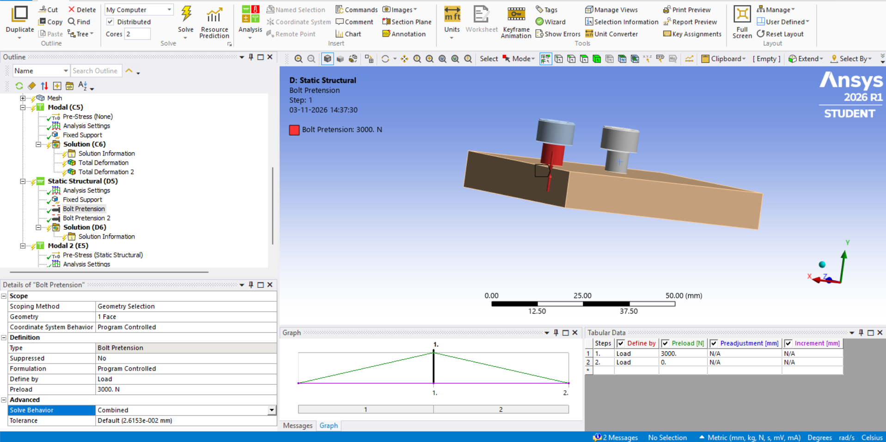<br><sub>Bolt Pretension, 3000 N</sub></td>
</tr>
<tr>
<td><br><sub>Frictional contact, mu 0.2</sub></td>
<td>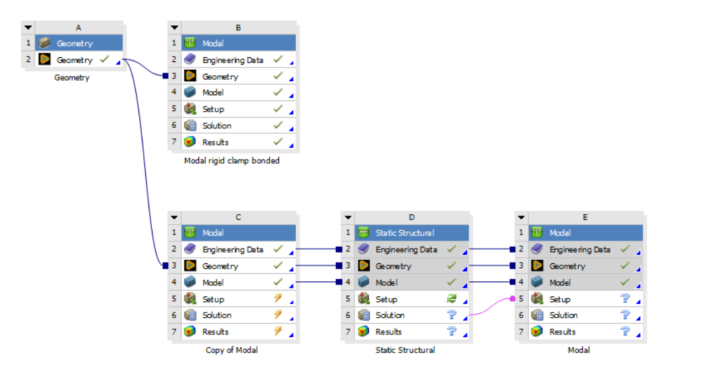<br><sub>Workbench schematic: static result feeding the prestressed modal</sub></td>
</tr>
<tr>
<td>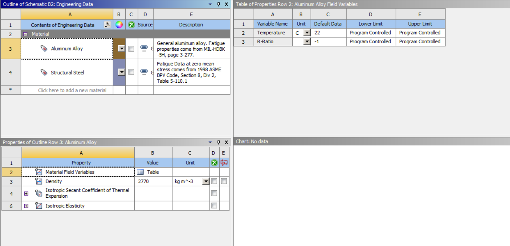<br><sub>Engineering data</sub></td>
<td>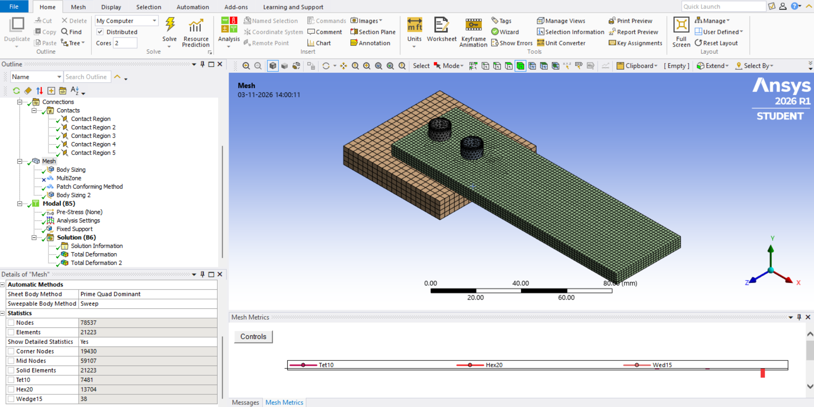<br><sub>Mesh overview from the bonded convergence study, 78,537 nodes</sub></td>
</tr>
</table>

## Checks before the sweep

| Check | Result |
|---|---|
| Hand calculation, cantilever with tip mass, rigid clamp (`scripts/handcalc.py`) | f1 = 86.8 Hz |
| FE with a bonded joint, 3 mm mesh | f1 = 83.71 Hz, 3.6% below the rigid clamp value, as expected for a clamp that is not rigid |
| Mesh convergence of the bonded model, 3, 2 and 1.5 mm | 83.71, 83.82, 83.72 Hz, within 0.13% |
| Bonded f2 on the 3 mm mesh | 471.27 Hz |

<table>
<tr>
<td>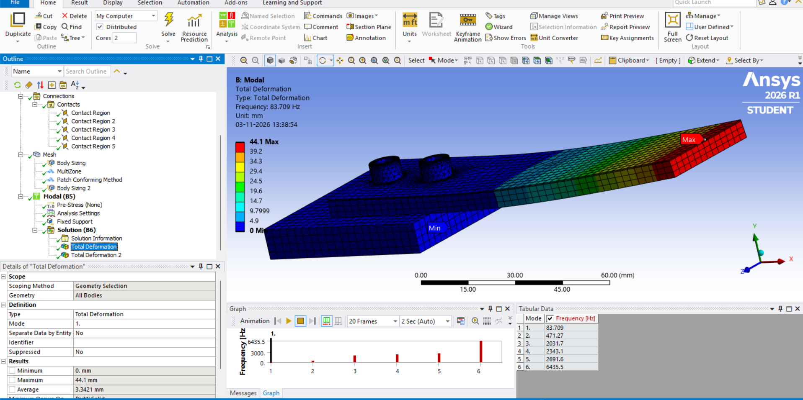<br><sub>Bonded model, mode 1, 83.71 Hz</sub></td>
<td>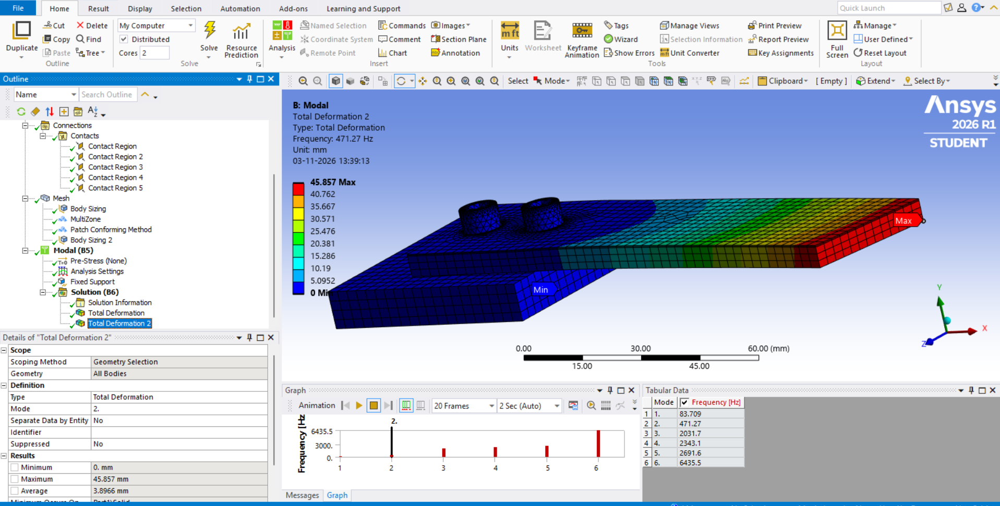<br><sub>Bonded model, mode 2, 471.27 Hz</sub></td>
</tr>
</table>

## Results

All runs: 3 kN per bolt unless stated, mu 0.2 unless stated. Raw data in `data/results.csv`, solver output in `solver_output/`.

| Case | Preload (kN) | mu | Hole (mm) | Plate mesh | Shank contact | Nodes | f1 (Hz) | f2 (Hz) | f3 (Hz) | Peak pressure (MPa) |
|---|---|---|---|---|---|---|---|---|---|---|
| R1 | 1 | 0.2 | 6.0 | hex | active | 57,582 | 78.387 | 323.92 | 1864.5 | 27.2 |
| R2 | 3 | 0.2 | 6.0 | hex | active | 57,582 | 78.436 | 325.56 | 1865.9 | 81.7 |
| R3 | 6 | 0.2 | 6.0 | hex | active | 57,582 | 78.574 | 327.42 | 1869.9 | 163.4 |
| R4 | 8 | 0.2 | 6.0 | hex | active | 57,582 | 78.579 | 328.08 | 1870.1 | 211.3 |
| R5 | 3 | 0.1 | 6.0 | hex | active | 57,582 | 78.174 | 286.78 | 1858.4 | 81.9 |
| R6 | 3 | 0.3 | 6.0 | hex | active | 57,582 | 78.644 | 346.24 | 1872.1 | 81.5 |
| R9 | 3 | 0.2 | 6.0 | hex | suppressed | 57,581 | 78.310 | 321.30 | 1861.5 | 82.1 |
| R10 | 3 | 0.2 | 6.0 | tet | suppressed | 43,859 | 77.931 | 241.61 | 1849.0 | 72.4 |
| R7 | 3 | 0.2 | 6.2 | tet | suppressed | 34,153 | 78.015 | 256.20 | 1852.5 | 78.0 |
| R8 | 3 | 0.2 | 6.6 | tet | suppressed | 43,852 | 77.782 | 240.43 | 1844.4 | 83.9 |

Bonded references: f1 = 83.71 Hz and f2 = 471.27 Hz (hex, 3 mm mesh, 6.0 mm hole). On the tet mesh with the 6.6 mm hole the bonded model gives f1 = 83.92 Hz, f2 = 471.44 Hz, f3 = 2039.4 Hz, so a bonded joint does not feel the hole size or the mesh type.

### Preload and friction

<table>
<tr>
<td>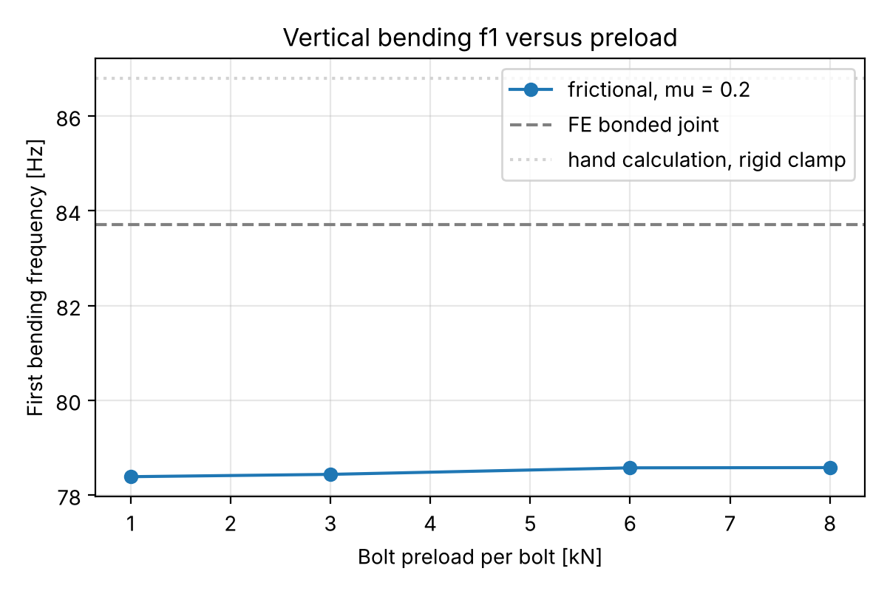</td>
<td></td>
</tr>
<tr>
<td colspan="2" align="center"></td>
</tr>
</table>

The first bending mode (vertical, f1) bends the thin direction and is dominated by the beam, so it hardly sees the joint. The lateral mode (f2) bends the bracket in its stiff 40 mm direction, so the clamp has to carry a large shear and moment through friction at the interface. A plausible reason for the pattern is that friction decides how much of that interface sticks, while extra preload adds little once the interface already sticks at 1 kN. I did not separate this further.

<table>
<tr>
<td><br><sub>R2, mode 2 (lateral bending), 325.56 Hz</sub></td>
<td>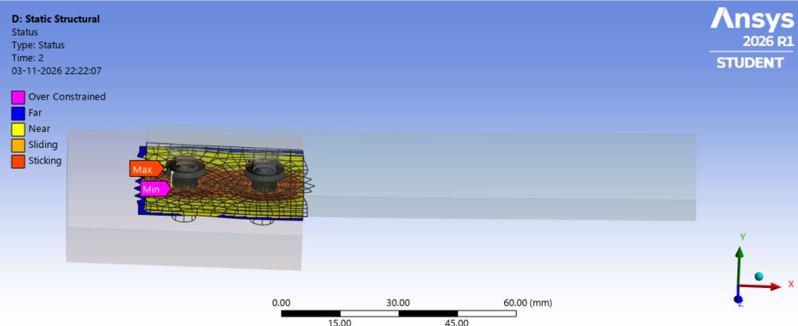<br><sub>R2, contact status after preload</sub></td>
</tr>
<tr>
<td>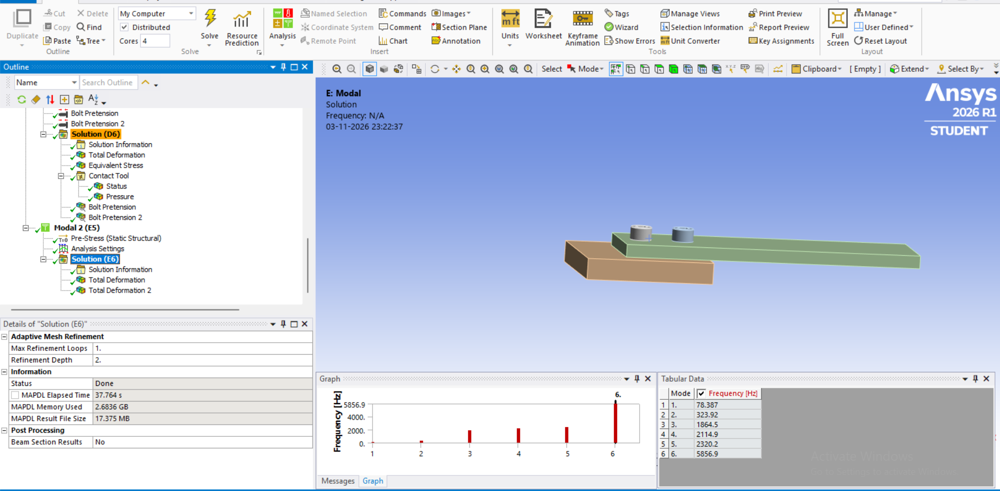<br><sub>R1, frequency table, 1 kN</sub></td>
<td>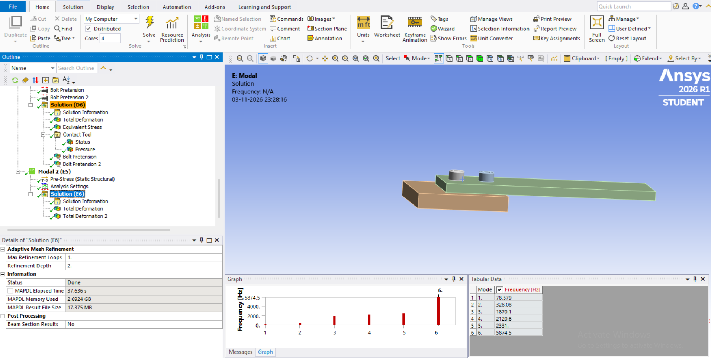<br><sub>R4, frequency table, 8 kN</sub></td>
</tr>
<tr>
<td>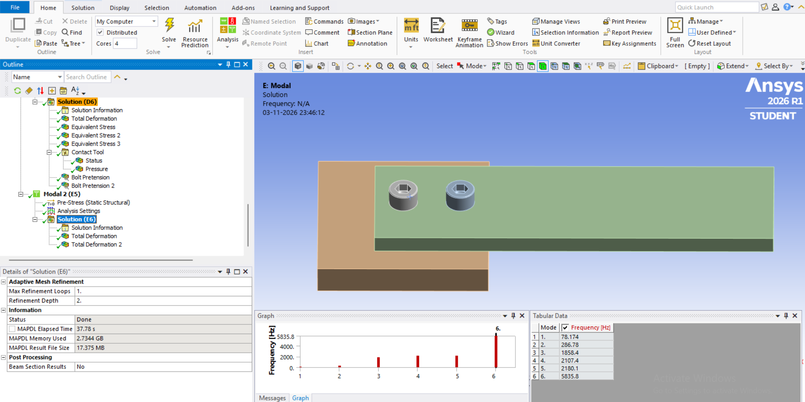<br><sub>R5, mu 0.1</sub></td>
<td>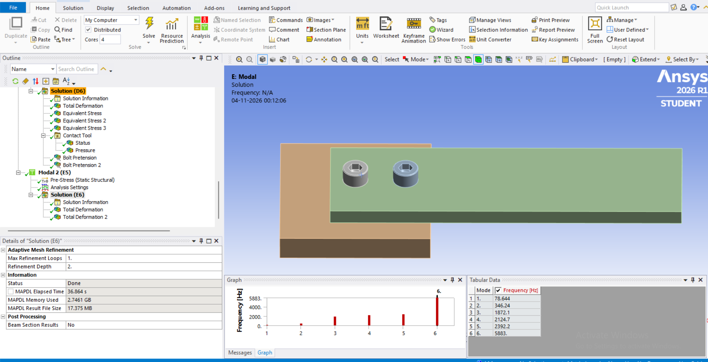<br><sub>R6, mu 0.3</sub></td>
</tr>
</table>

### Hole clearance, shank contact and mesh type

I wanted to know whether a hole larger than the bolt changes the modes. In a linear prestressed modal analysis the answer depends on what carries the load between bolt shank and bracket hole, so I separated three effects at 3 kN and mu 0.2.

| Comparison | Only difference | f2 change |
|---|---|---|
| R2 to R9 | shank to hole contact removed (6.0 mm hole, hex) | 325.56 to 321.30 Hz, minus 1.3% |
| R10 to R8 | hole 6.0 to 6.6 mm (tet, shank contact suppressed) | 241.61 to 240.43 Hz, minus 0.5% |
| R9 to R10 | plates from hex to tet (6.0 mm, shank contact suppressed) | 321.30 to 241.61 Hz, minus 25% |

Conclusions:
* Once the shank contact is suppressed, the hole size has almost no effect on the linear result, because nothing in the model touches the hole wall. Real clearance acts through impacts and slip, which needs a nonlinear transient study.
* The 25% jump between hex and tet plates appears only with friction on. The bonded model gives the same f2 on both meshes (471.27 and 471.44 Hz), so the plates are equally stiff. What differs is the stick and slip state at the bolt head and the bracket interface after preload, and that state depends on the mesh. I cannot say which mesh is closer to reality without a physical test, which this project does not include. Hex elements are normally preferred for contact, which is why the preload and friction sweeps use them.
* For the application this means: trust the trends of the sweeps (preload weak, friction strong), and treat the absolute lateral frequency as uncertain by about plus or minus 15% until a finer hex mesh study narrows it.

<table>
<tr>
<td>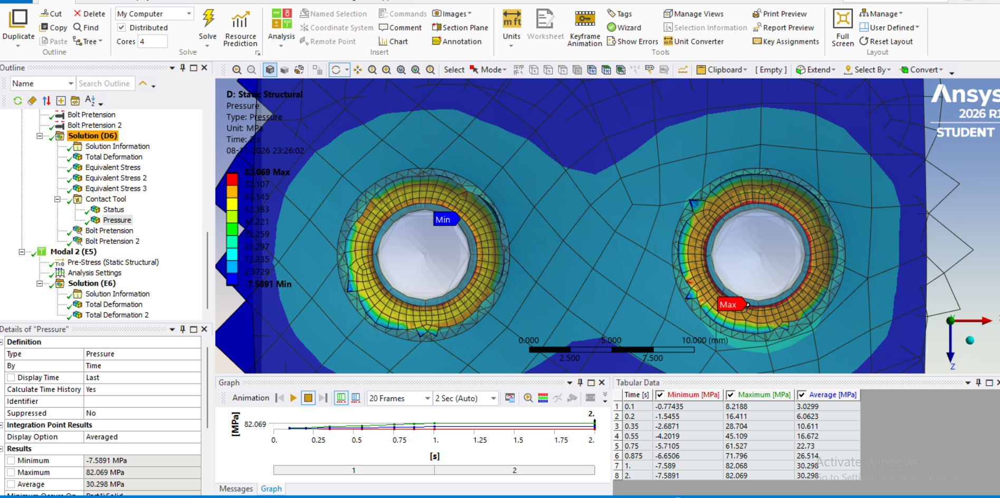<br><sub>R9, 6.0 mm, hex, 57k nodes, peak 82.1 MPa</sub></td>
<td>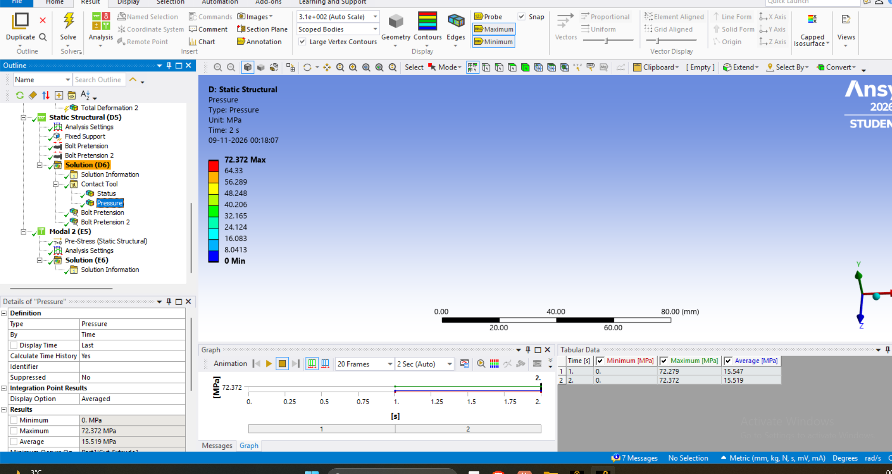<br><sub>R10, 6.0 mm, tet, 44k nodes, peak 72.4 MPa</sub></td>
</tr>
<tr>
<td>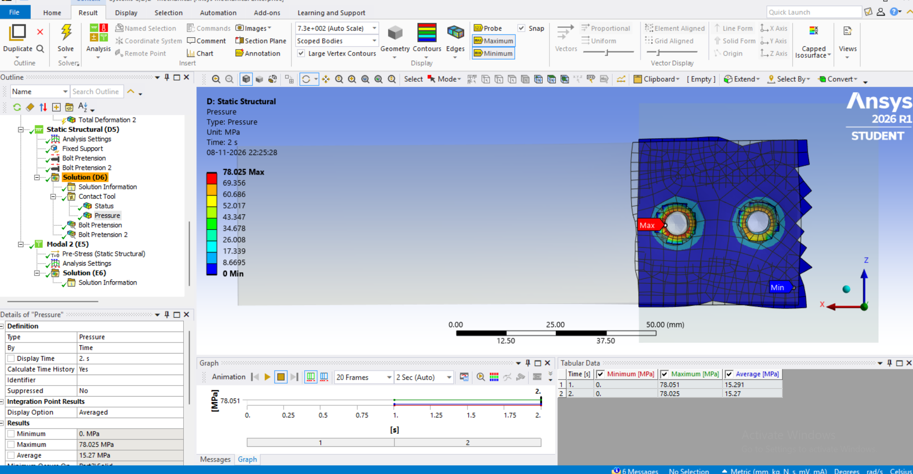<br><sub>R7, 6.2 mm, tet, 34k nodes, peak 78.0 MPa</sub></td>
<td>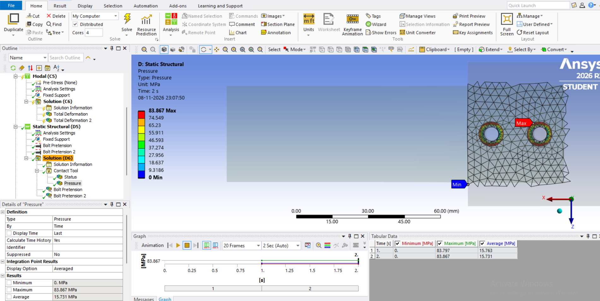<br><sub>R8, 6.6 mm, tet, 44k nodes, peak 83.9 MPa</sub></td>
</tr>
<tr>
<td colspan="2" align="center">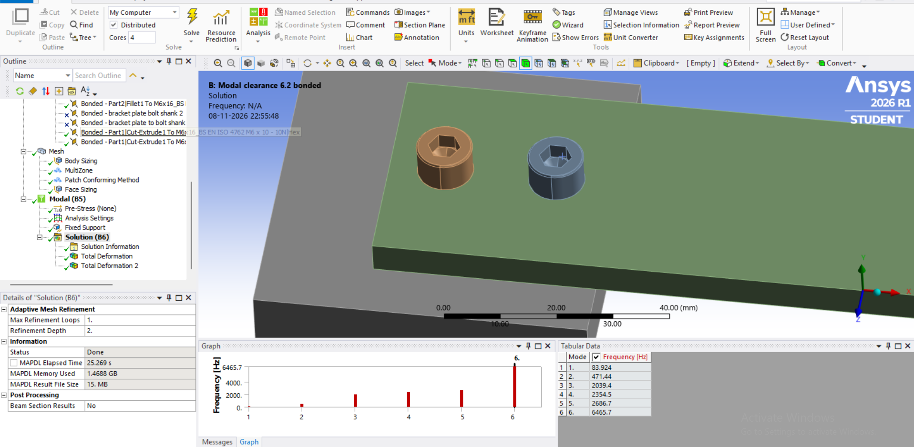<br><sub>Bonded check on the tet mesh, 6.6 mm hole, f2 = 471.44 Hz (the window title still reads 6.2 because the modal feature was copied)</sub></td>
</tr>
</table>

### Contact pressure and stress


The peak pressure (blue) grows linearly with preload but is a local edge value that depends on the mesh. At 3 kN it reads 72 to 84 MPa on meshes of 34k to 57k nodes. A first, superseded run on a 92k node mesh with face sizing read 211 MPa at 3 kN (`screenshots/pressure_peak/`), the same number as the 8 kN peak on the 57k mesh, which is a coincidence and not a result. The mean pressure under the head (orange, preload divided by an estimated ring area of 48 mm2) is mesh independent: 62, 125 and 167 MPa at 3, 6 and 8 kN. At 8 kN the mean is 60% of the 280 MPa compressive yield of the aluminium. The pressure plots show the highest values at the inner edge of the contact ring next to the hole, consistent with the head dishing slightly under load. A hardened washer would spread that load.

Stress at 8 kN (`screenshots/stress/`):
* Bracket peak 202 MPa, below the 280 MPa yield.
* Bolt peak 707 MPa at the sharp head to shank corner, which has no fillet in the model, so this is a singularity. The nominal bolt stress is 8000 N over the 20.1 mm2 stress area, about 398 MPa. That is above the 250 MPa yield of the default steel used in the model, but below the 640 MPa yield of a real 8.8 bolt (62%). The analysis is linear, so the value is not capped at yield, and the bolt grade does not change any frequency.

<table>
<tr>
<td>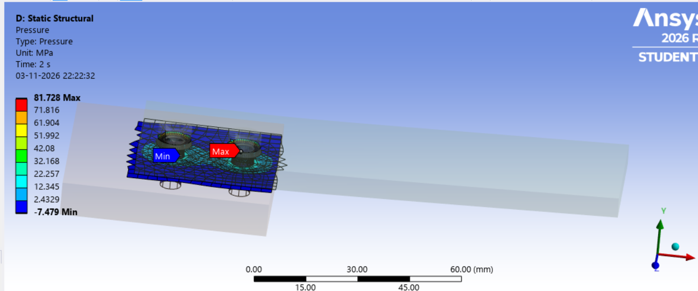<br><sub>R2, 3 kN, peak 81.7 MPa</sub></td>
<td>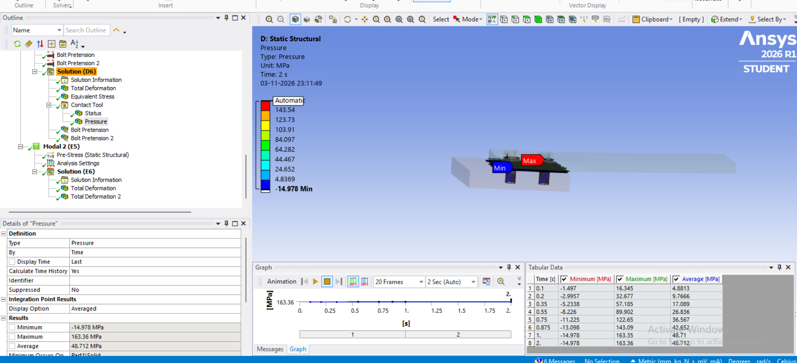<br><sub>R3, 6 kN, peak 163.4 MPa</sub></td>
<td>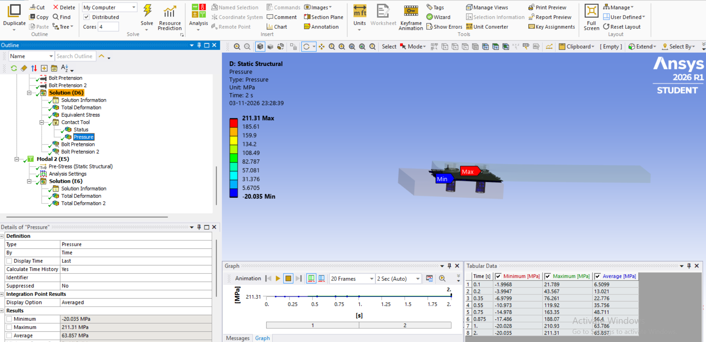<br><sub>R4, 8 kN, peak 211.3 MPa</sub></td>
</tr>
<tr>
<td>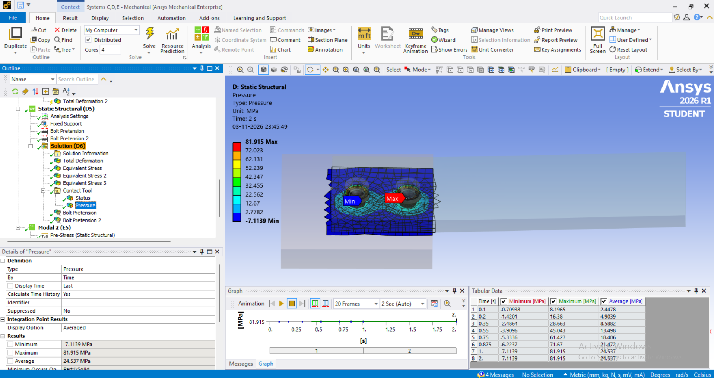<br><sub>R5, mu 0.1, peak 81.9 MPa</sub></td>
<td>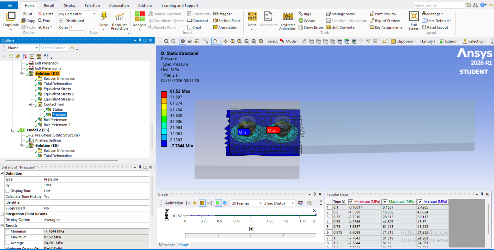<br><sub>R6, mu 0.3, peak 81.5 MPa</sub></td>
<td>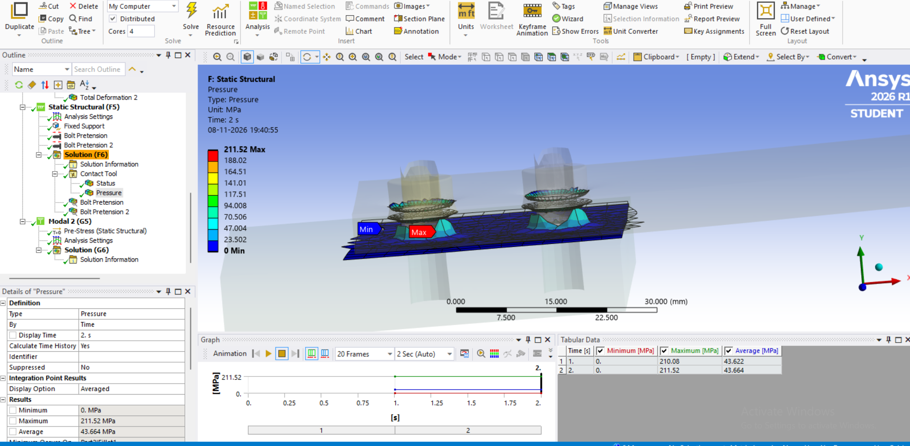<br><sub>Superseded 92k mesh run, 3 kN, peak 211.5 MPa</sub></td>
</tr>
<tr>
<td>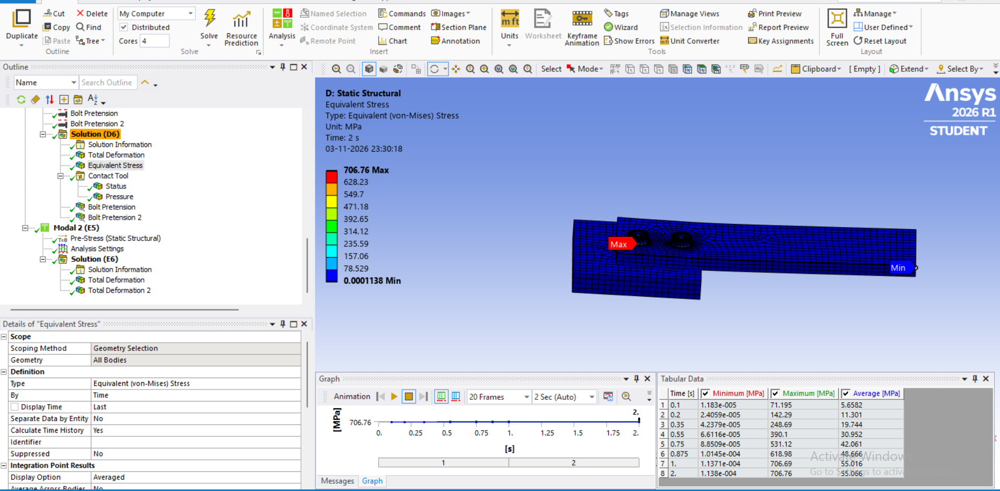<br><sub>Von Mises stress, all bodies, 8 kN</sub></td>
<td>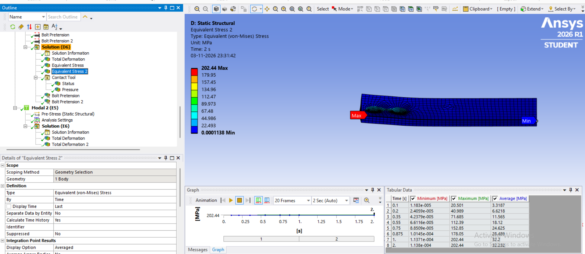<br><sub>Bracket, 8 kN, 202 MPa</sub></td>
<td>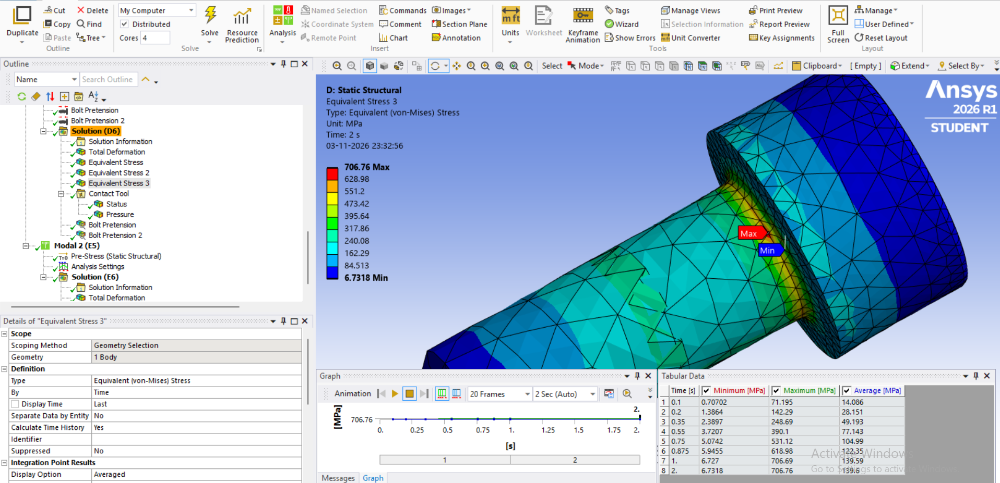<br><sub>Bolt head to shank corner, 707 MPa</sub></td>
</tr>
</table>

## How I checked the runs

The solver output has a mass summary by element type that works as a fingerprint of the model. It caught two mistakes in this study.

| Item | Mass |
|---|---|
| Bolt, M6 x 16 | 6.61 g (the Toolbox default M6 x 10 weighs 5.29 g) |
| Bracket, 6.0 mm holes | 92.13 g |
| Bracket, 6.2 mm holes | 92.06 g |
| Bracket, 6.6 mm holes | 91.93 g |
| Plate elements | SOLID186 means hexahedra, SOLID187 means tetrahedra |

The solver prints the masses in tonne (mm, tonne, N, s units), so 6.61 g appears as 0.661E minus 05.

* My first 6.2 mm run looked like a large clearance effect. The mass summary showed it used the short M6 x 10 bolts (the CAD library template had reverted), on a different mesh. That run is kept as `data/results_superseded.csv` and was not used. It was repeated with the correct bolts as R7.
* A later run that was meant to be 6.0 mm reproduced the 6.6 mm result to nine digits. The bracket mass showed the geometry had not been updated. After refreshing the geometry the mass matched 6.0 mm and the result changed.
* An early modal with several 0 Hz modes came from a missing Fixed Support in the static system. The solver output reports it as "No constraints have been defined".

## Limitations

* The contact status is frozen in the prestressed modal analysis. The study shows how preload and friction act through the contact state at lock, not slip under vibration. Amplitude dependent behaviour (impacts in a loose hole, microslip) needs a nonlinear transient study.
* Peak pressure and the bolt corner stress depend on the mesh. They are local peaks, not design values.
* The lateral frequency of the frictional joint differs by about 25% between hex and tet plate meshes (see above). A finer hex mesh study of the contact has not been done.
* The student licence limits the node count, which restricts how far the whole model can be refined.
* The bolt material is the default structural steel, not an 8.8 grade. The stiffness difference (200 against about 210 GPa) is small, and the stress comparison uses the real 8.8 yield value.
* The mean pressure uses an estimated contact ring area of 48 mm2.
* Simulation only, no physical test. The model is checked against a hand calculation and a bonded convergence study only.
* The tip mass is idealised as a rigid point at the end of the bracket.

## Next steps

1. Compare the joint stiffness with a published analytical joint model (VDI 2230 style compliance).
2. Finer hex mesh around the contacts to see whether f2 converges.
3. Nonlinear transient check of the range where the frozen contact assumption holds, including a loose hole.
4. Harmonic response with a damping ratio of 1 to 2%.
5. Repeat the model in Abaqus.

## Reproduce

```
python3 scripts/handcalc.py       # hand calculation, 86.8 Hz
python3 scripts/plot_results.py   # regenerates all figures from data/results.csv
```

Requires Python 3 and matplotlib. The Ansys project itself is not included because of its size. The solver output files in `solver_output/` contain the full model definition, contacts, mass summary and frequency tables for runs R3, R7, R8, R9 and R10.

## Repository layout

| Path | Content |
|---|---|
| `data/results.csv` | all runs used in the study |
| `data/results_superseded.csv` | first 6.2 mm attempt with the wrong bolts, not comparable |
| `figures/` | plots made by `scripts/plot_results.py` |
| `screenshots/` | Ansys screenshots, grouped by setup, verification, sweep, stress, pressure peak and clearance |
| `solver_output/` | MAPDL solver output text files |
| `scripts/` | hand calculation, plotting, drawings |
| `docs/` | bracket drawings |
